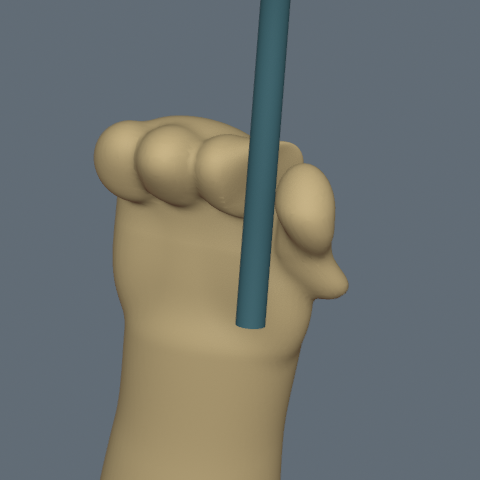

# 《小肥柴的世界研发日志U20261113》

背景：熟悉俺的朋友都知道在下是个比较专一的人，账号、昵称、头像、表情一用就会保持很多年，如果没有意外会一直用到死。

喜欢小肥柴主要是它头大，俺也头大；比较肉，巧了之前确实当过一段时间200斤的胖子；还憨憨贱贱的，咳咳，俺时不时亦然。用小肥柴就感觉是自己上场了似的，能不爱用吗啊？

平日管理社群，时不时社友键政啥的，群挂了一些，为了降低被封概率，多年前就把微信转成了国际版WeChat，但这也带来一个后果——没法再买国内的付费表情包了，微信豆一直无法充值。

急死个人就，只好各路搜集网友发的小肥柴表情，放在收藏夹里用，但也不是办法。AI大行其道的时候，为什么不自己研发呢？

## 让AI直接学原表情

最开始俺是用爬虫从互联网上搜集了小肥柴的表情，包括原作者出的系列、合作的广告联名、微博发的节日背景图等等，一共撸了上千个到本地。

开始想让ChatGPT通读所有表情，相信它的能力，让它基于原作者的功力迁移创造，结果当然是不理想，最烂的一批俺都没保存，直接删掉了，下面是早期技术管线里还能用的。

这是那时候留下的一张表情设定草案。还有一张把它转过来给你看侧面和背面，用现在的眼光看，也能明白当时俺为什么觉得这条路有戏。[同阶段的正、侧、背三视图](2D/early-turnaround.png)

俺还记得那张工厂配图。夕阳照着烟囱，桌上摊着笔记本，狗子一手托腮一手拿笔，连班味儿都有了。单看是张挺好的图，可你遮住背景只看那张脸，哪位啊？「肥」「柴」「贱萌」三个词它全听进去了，最后给俺画了只颇有心机的普通柴犬。

当时也动过念头，给它练个 LoRA，再不行租显卡。后来先做了件便宜得多的事：同样画一个动作，分别给模型看标准脸、全身比例和动作参考。这样至少能找出它究竟改了眼神，还是把身子拉长了。到这篇更新为止，下面的成果都没用上咱们自己训练的小肥柴 LoRA。最早说的“学”，实际做的是把参考图放进那一次生成里给模型看。

## 从八月的素材夹，到九月的第一只会眨眼的柴

翻回 8 月 25 日的盘点，当时一个文件夹里就有 735 张微博 JPG。按尺寸大致能分开表情和壁纸，哪张才适合当角色参考还得接着看。隔天，同人站的另一批素材里又整理出 359 张贴纸、29 个头像、33 张壁纸。俺们试着让 AI 画正侧背、脸、爪子和十二种表情，好留给下一位接手的模型。[脸怎么画](2D/early-face-construction.png)、[爪子怎么摆](2D/early-paw-gestures.png)，当时也各画了一板。现在回看，这四张算咱们的设计草案，拿去给原作者当设定集，估计人家都要问问这谁家的狗。

俺们最早做了三个小实验：一只眨眼，一只头顶冒问号，还有一只敲木鱼。敲木鱼那张有 15 帧，把每一帧的色块描成 SVG 路径，在浏览器里一帧接一帧放，确实能敲。眨眼容易些，把眼睛单独分层，压扁再展开，远看有那么点意思。一看大图就露馅了，闭眼哪能只是把睁眼压成饼呢。

抠背景也闹过笑话。有张图的白肚皮一直伸到画布外，程序从画布边缘出发清背景，顺便把狗肚子也给清了。木鱼敲上了，狗肚皮却漏了风。后来先在裁切处临时封住躯干边界，再让程序找背景。这件小事改变了俺们看 SVG 的方式：放大不糊只解决了一件事；想让它抬手，手后面那块原本根本看不见的身体，还得有人补出来。

咱们还自己用几何形状搭了十二张脸，试试看只换几笔眼睛和嘴，就能分出多少情绪。SVG 的好处是连怎么画这一笔都能翻开看。[九月自绘的中性脸](2D矢量/202609-neutral.svg) · [十二种表情 SVG](2D矢量/202609-face-sheet.svg)

描摹原图时又碰到另一道题。把一张图压成四种主色，黑线是利落了，眼白也给省掉了。后来把颜色拆开分别描，才把眼白找回来，耳尖的曲线依旧能看出折点。到这里，才知道验收一只眼睛得看它里面还剩什么。

后来在 Sigstick 用「小肥柴」当关键词搜到 64 个包、1,766 个贴纸位置，下载出来却有 2,569 份文件。一张贴纸有时同时给原图、压过的静态预览，光数文件就能把研究规模吹大一截。遇到动图还得往后翻几帧，头一帧可能只有张空桌子。

这个时期俺又想起一件事：小肥柴出过小孩版，也有成年版。小孩身子矮，脑袋自然显大；俺平常最爱用的那一批，主要是成年版。先前大家围着一个模型辩论头该大一点还是小一点，有些争论其实是在拿两只不同时期的柴互相校准。后来给它们分开建档，先做成年版。

做动作也闹明白一件事。九月拿两个不同比例的假人试挥手和摸嘴，手臂给短了，关节算得再准，手尖照样够不着嘴。同一时期用 HyperFrames 做过一段 90 帧的小视频，确实能把合成画面导成 MP4。假人的手够不够长、小肥柴的脸像不像、视频能不能导出，得各考各的。

九月的整身稿也留了一张。看看肩膀下面像挂着的两根胶囊，再看后面十月的手掌，就知道“从零重做”有多容易重蹈覆辙。[九月被退回的第五版实模渲染](3D/202609-v05-render.png)

## 十月，推倒重建，怎么又长回去了

当时俺给的评语很不客气：脸不够圆，手和肚子的曲线不对，像便宜玩具。侧面再看，肩头像扣了个盖，手掌像在胳膊末端粘了一颗拳头。让 AI 从空白 Blender 场景重新建，结果它仍凭眼睛估几个椭球有多大、该摆在哪儿，再把交界处抹平。工程文件确实是新的，那颗拳头也确实又长回来了。

真正让结果靠近了一步的，是把参考图的像素拿来参与造型。先量正面的外轮廓，再用侧向参考约束厚度，让轮廓包围的面向里外鼓起。这里用过的成年转面设计稿是项目里的造型假设，后来判断“这还是不是小肥柴”，咱们又回去看原作者的表情。一张咱们自己画的图当老师，再用另一张咱们自己画的图打分，这条路走久了容易自娱自乐。

换方法也有代价。参考图里，手臂贴着肚子时只有一条墨线，线后面有多少肉，图上没交代。有一版把肩根鼓得冒出两只小翅膀。俺看明白了，正面轮廓能叠得很齐，狗转过去仍然能吓你一跳。

## 十一月上旬，一键转 3D，下载回来记得转个面

11 月 5 日有一对自家生成的转面图挺值得留着。俺们只想把中间那只转到左前方四十五度，再看它的脸颊有多厚。把两张放在一起切换，正面和背面的身体比例也跟着变了。一张图里有三只长得像的柴，未必是同一只柴转了三个方向。下回要量厚度，这两个版本都只能当猜想。[第一版转面图](2D/20261105-turnaround-v1.png) · [改中间视角后的第二版](2D/20261105-turnaround-v2.png) · [同一轮的六格表情](2D/20261105-expressions.png)

既然咱们手写得丑，专业工具总该试试。SF3D 确实吐出了能下载、能在 Blender 里打开的 GLB 模型。正面认得出图案，转过九十度，近似一张有浮雕的贴纸。Pixal3D 后来跑出了服务端预览，试用环境在导出时碰到时长上限，这次没拿到模型。Meshy 等工具也做过路线调研，这几件事得分别记账，不能凭某家的宣传图给自家模型评个奖。

俺们还拆看过游戏 Saltline。俺尤其喜欢游戏美术的一点：场景里换盏灯，角色还是那个角色；手腕抬起来，手里握着的道具也得跟着走。这套思路后来用在部件审阅台上。每个部位都有自己的挂点，同一个文件能换固定镜头、看灰模、拖动作。至于狗子怎么动，俺倾向于拿它当「披着狗皮直立走路的人」：二足动作可以从人的套路入手，短胳膊能不能够到嘴、举手会不会穿过大脸，仍得用这副身子试。骨骼、形变和动画能从 Blender 送进浏览器，这段路通了；整只柴自然地动起来，账还欠着。[咱们做的双骨骼与形变回放样件](3D/rig-probe/)

## 11 月 13 日，脚边那两点，到底留不留

「疯狂示好」那张，俺特别喜欢它脚边的两个小点。单抠出来谁也看不懂，放回脚尖旁边，就知道这狗子表面还端着，脚底下已经忙得很。AI 高清重画的时候一度把这两点丢了。它还给耳朵里面上了阴影，却让背到身后的手、肚皮挡住的小腿亮着一线黄。轮廓大致对了，那种憨憨的劲儿却跟着这些小地方一起没了。

偏偏把同一张表情拿去做三维的时候，脚边两点又该拿走。俺们用同一版生成工具、同一组参数和随机种子做过对照，只清理角色外围的白边和游离记号，再生成，先前穿过身体的矩形片消失了。于是这张图留两份：聊天用的高清表情要把脚边两点好好留着，给三维工具看的输入单独清理。人眼知道哪两笔是声响，软件可没答应你它也懂。

标题里的 U20261113 就留在这里。这天定下来的顺序是先把 2D 母稿做好，再做矢量分层，把高清图与结构参照交给 3D。后面的日期往下接，看看这条路到底能走多远。

## 11 月 16—19 日，分辨率提高了，怎么嘴边还有毛刺

先记个打脸的结果。换一张更大的高清输入试转三维，模型身上又插了两块大板子。确实查到透明区有肉眼几乎看不见的杂点，模型服务在推理前怎么处理这些点却没拿到实证。俺们只能记录这次失败，再设计对照。把“可疑”两字换成“破案”，下一位接手的朋友准得白忙一轮。

11 月 18 日俺还专门让一个独立的 AI 只领目标，不给技术路线，从零用代码建一只。第一只做的是坐姿，头身一转就生分；再给它高清全身图，终于能还原背着的手和弯着的脚。补了三面参考和侧面设计板，厚度总算能逐段量，可耳窝仍像在耳朵上涂了一块黄。给多少参考、选哪张当尺子，真会改结果。

又有一版很有意思：眼睛黑框挺圆，紧挨着的眼白和嘴线却有锯齿。明明已经有矢量图了，毛刺打哪来的？拆开几版出问题的模型一看，文件里连纹理图都没有。那一轮直接从高清图取颜色，涂在三角网格的顶点上，顶点之间的颜色让电脑猜。黑框有自己的形状，眼白边界只能跟着三角面走。咱们在另一条线上做好的分层矢量嘴，从头到尾就没进这次导出。后来俺们看交付物多了个动作：关掉制作软件，把别人真正会收到的那个文件重新打开。

与此同时，2D 这条线终于清了一轮库存。最后保留 **2,147 组**，其中 274 组是动画，连静图一共处理了 **6,703 帧**。这些数字说的是本地研究规模：251 组能追溯到作者账号，752 组来自有署名的转载包，还有 1,144 组来源待证。甚至从作者账号收来的图也得认角色。有一条微博的九张配图差点混进来，回看作者的配文，画的是给《英雄联盟》柯基库奇定制的「小肥基」。差一个字，真是另一只狗。[作者当年的说明](https://weibo.com/2284144087/HoR2g1j4d)

批量高清化采用保守放大，透明母版另外保留；人工和 AI 精修的样张另算。白底专门多看了一轮，把黑轮廓外面那层像手机膜的细灰边收掉。逐帧矢量化后还有 47 组触发了颜色或边界误差提示。单拿「疯狂示好」细分，可以拆出 33 层，连足尖两点都有各自的位置。全库都有矢量路径，和全库的手脚都能随意摆，这中间还隔着相当多活儿。

## 11 月 19—20 日，先给俺握住这根镜柄

旧整身模型装过 17 根骨骼，也能转头，看惊讶版能瞪眼，看笑脸版能咧嘴。俺还是把它退回去了。换了表情，僵硬的手、肚子和接缝仍在同一个地方。再花一轮算力重做整只柴，脚好看了，谁敢担保脸没变？

这次咱们挑一只手，给它留一截前臂，再递给它一根圆镜柄。第一版抓握，整只手腕弯成了钩。对照拿镜子的原画，镜柄是被拇指一侧和指腹从两边夹住的。第二版就固定腕部，只动该动的两处，用同一根柄试了 72 帧。脚也单独做，抬脚跟时盯着前脚掌，看它有没有悄悄离地。两件都能动，还有得挑。手指节偏鼓，脚踝画得比原作对称。

[下载右手动作模型（不含镜柄）](3D/adult-paw-grip.glb) · [下载抬脚跟模型](3D/adult-foot-roll.glb) · [侧看前脚掌着地](3D/foot-roll.png)

脸部最费神的是嘴下面那一小笔。在独立的口鼻样件上，舌头一度和嘴各播各的，普通播放器只选中一个动作，嘴张了，舌头还在等通知。合到同一条动作上再接脸颊，转过侧面又发现那一小笔悬空，嘴角两道斜沟一路扯到脸边，张嘴时还有一小片黑色口腔戳出白脸。正面静态截图，能把这几样全藏住。

现在可以在同一张脸上切闭嘴、半张、笑开，再转到正侧面看。嘴下那一笔已经贴着曲面走，在 512 像素的张嘴图里离嘴底约 8 像素，按头宽折算和原作接近。白颊下边两个角还收得偏尖，侧后脑的亮带也还有点硬。俺愿意拿这一版出来请人挑毛病；整只柴的长相和动作，留给后面的日志接着验。

这轮脸的眼部纹理直接取过参考原图，这份整脸模型和渲染也没放进公开仓。能在这里下载和转着看的，是咱们自己搭出来的手、脚和骨骼实验。

这是学姿势网的非官方研究，角色出自原作者。这里开的是咱们自己的研发账本。原作者的贴纸、头像和壁纸请到原来的出处看。对这些图做的高清放大、逐帧描摹，以及模型里直接取自原图的贴图，也都只供内部研究。往后每回有新实验，俺们就连同哪版翻了车、凭啥说这次好了一点，一起往这篇下面续。

**本次更新写到 2026 年 11 月 20 日。** [2D 图稿](2D/) · [2D 矢量](2D矢量/) · [3D 资产](3D/)
