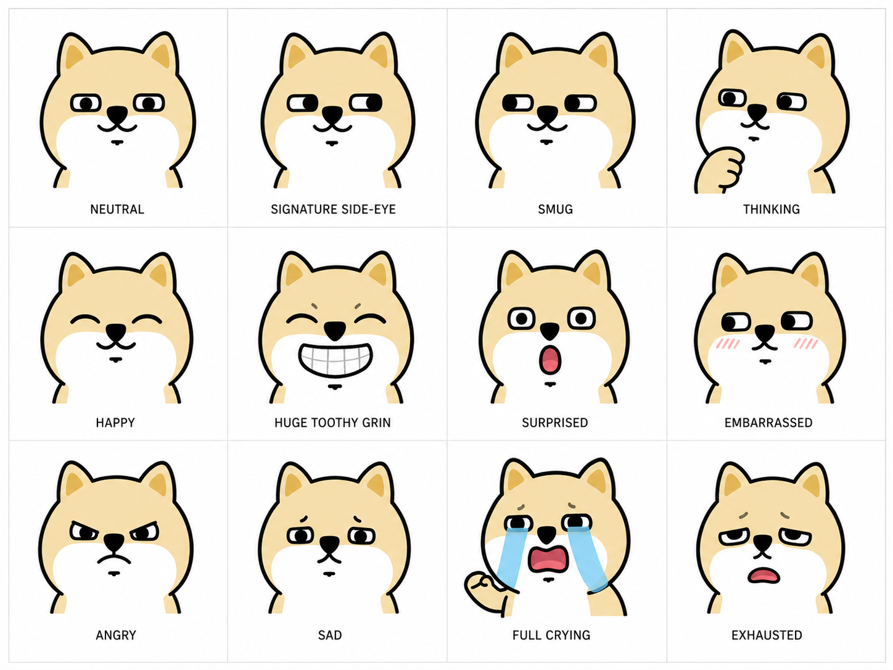
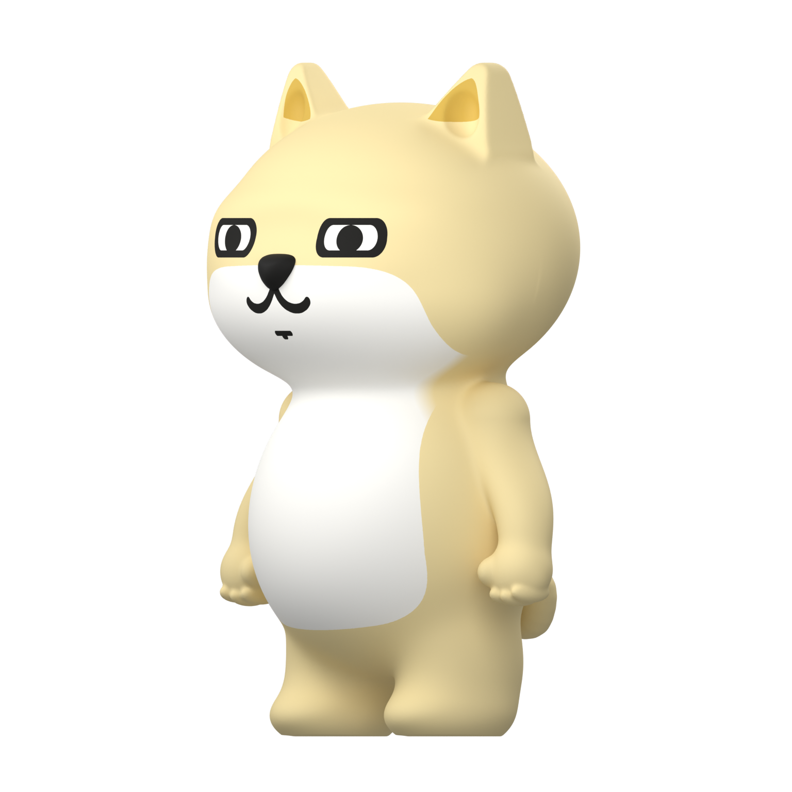

# 《小肥柴的世界研发日志U20261113》

背景：熟悉俺的朋友都知道在下是个比较专一的人，账号、昵称、头像、表情一用就会保持很多年，如果没有意外会一直用到死。

喜欢小肥柴主要是它头大，俺也头大；比较肉，巧了之前确实当过一段时间200斤的胖子；还憨憨贱贱的，咳咳，俺时不时亦然。用小肥柴就感觉是自己上场了似的，能不爱用吗啊？

平日管理社群，时不时社友键政啥的，群挂了一些，为了降低被封概率，多年前就把微信转成了国际版WeChat，但这也带来一个后果——没法再买国内的付费表情包了，微信豆一直无法充值。

急死个人就，只好各路搜集网友发的小肥柴表情，放在收藏夹里用，但也不是办法。AI大行其道的时候，为什么不自己研发呢？

## 让AI直接学原表情

最开始俺是用爬虫从互联网上搜集了小肥柴的表情，包括原作者出的系列、合作的广告联名、微博发的节日背景图等等，一共撸了上千个到本地。

开始想让ChatGPT通读所有表情，相信它的能力，让它基于原作者的功力迁移创造，结果当然是不理想，最烂的一批俺都没保存，直接删掉了，下面是早期技术管线里还能用的。

## 8 月 25 日深夜，俺以为把狗子的长相讲明白，这事就算会了

翻回第一晚，俺问的哪有今天这么复杂。俺想给学姿势网的配图找个常驻演员，以后写什么主题都让这只贱萌狗子上。俺给 ChatGPT 看了一堆图，请它先看懂，再教俺怎么告诉下一个 ChatGPT。它总结得还有点意思，大脑袋、短手短脚、脖子几乎看不见，小孩似的身形配上看透人情世故的眼神。俺一看，心想这不就懂了吗？

手里的图其实乱得很。8 月 25 日晚上的一份盘点里，光微博目录就有 735 张 JPG。按长宽、再抽样看，365 张归到贴图或漫画，300 张手机壁纸，52 张桌面壁纸，14 张宣传图，还有 4 张坏文件。手机壁纸画得漂亮，角色在画面里可能只占一小块。漫画把狗的动作画全了，却也可能一张有好几只。后面那句“一共撸了上千个”是几处来源陆续凑出来的，第一夜手上可没有上千张规规矩矩、排好队让模型学的标准脸。

到了 26 日零点，俺催着它把长相说明、配色、提示词放进设计系统，连入口该用什么 emoji 都讨论了。它挑了只 🐕，又配了个 😏。起初目录藏在好几层里，俺嫌麻烦。以后每张配图都要用这狗，哪能回回翻箱倒柜？目录改浅，仓库首页放入口。俺当时设想的用法很美，给一个链接，再填上这期配图的主题就完事了。

零点二十四分，头一张拿回来的配图就让俺破防了。翻到当时的对话，俺的原话是“ChatGPT生成的，俺感觉还是不像，崩溃，没起作用啊。”工厂快下班的样子，夕阳穿过烟囱，图纸铺了一桌，电脑开着，狗子一手托腮，一手握笔，远处竟然还有一只背对着俺。气氛它是真会画。可近处那位长了两点白眉毛，眼睛是往下斜的半眯眼，嘴巴前面鼓着一小团白毛。俺那只狗的眼神，是黑色横眼框里面一小截眼白和偏向一边的瞳孔凑成的；白色从双颊一直兜到下巴。你把背景遮住，两位根本认不成亲。回头翻设计目录，这才发现，里面尽是我们在说它长什么样，连一张能对着看的本人照都没有。俺让模型读懂了中文，它倒也忠实地给俺画了“一只很贱萌的肥柴犬”。

## 8 月 26 日零点半，先借游戏画师的办法，给它做档案照

俺换了个问法。假如请三位不同的画师来画同一个游戏角色，总不能让三个人分别读一遍形容词。能不能先做三视图，把脸、爪子、表情也一板一板给出来？第一板试了正面、侧面、背面；第二板把眼、鼻、白脸兜和下巴的小短线摊开看。爪子特地画了指、托、握笔、点击、抱臂等九种动作，一板又排了十二种表情。上面那张就是当时的成果。[早期三视图](2D/early-turnaround.png) · [脸部构造板](2D/early-face-construction.png) · [九种爪子动作](2D/early-paw-gestures.png)

板子有用，俺终于能说出是哪里不像了。正面有了点那意思，转过去口鼻该伸多少、尾巴该怎么卷，还是画师自己猜的。个别爪子仔细一看，已经快能替俺敲键盘了。尤其十二种表情摆得工工整整，俺实际在微信群里用的那只，远比这板上的活泛。俺让它先停生成，转头去找那种连中文意思都标好了的表情站。一个“疯狂示好”，比一句“可爱站姿”更能解释作者为什么要让它背起一只手。

这一找又漏了东西。工头先报告抓到了 359 张 GIF，挑出 483 张画面变化明显的关键帧。俺点开网站，明明旁边还有「头像」「壁纸」两个标签，顺口一问，它才承认刚才只进了贴纸栏，又补了 29 个头像、33 张壁纸。头像缩得小，一眼认不出是谁就真失败了，最适合检查眉眼；壁纸刚好相反，能看远景里手脚怎么摆。用途一分开，这两个漏掉的栏一下有了价值。那批关键帧里筛出了 460 张单角色候选，另有 23 张因背景复杂或角色太多退回。目录里甚至有训练、验证两份划分。当时做完的是选帧和标注，硬盘里没有一份新训练出来的小肥柴权重。

## 还是这一夜，工作站里凭空多出来一张 4090

俺一边还在想办法补自己的微信表情收藏，一边问了个很实际的问题。要真给小肥柴练一份 LoRA，也就是让图像模型专门学这个角色，以俺这点儿设备，哪台跑得动？助手翻设备台账，头一个推荐俺的 RTX 4090 工作站，还解释了 24 GB 显存有多好。俺当时只回了一句，“没4090，你修正一下台账。”

实机加图吧工具箱一对，i7-14700K，32 GB 内存，显卡是处理器自带的 Intel UHD 770。前两样拿来切图、解动图、算重复、做标注挺好使，最后一样和那张想象中的 4090 可差远了。更有意思的是，过了一个多小时俺去主分支看，4090 居然还在。回来追问才发现，它把修改放进了一个待合并的请求，俺平时看的设备清单当然没变。这次合并，再从俺那个链接打开，才算那张卡真的从俺家消失。后来有谁跟俺说“已经修了”，俺习惯多问一句，俺打开的那份修了没有？

没有卡，那就租？那晚俺连着问了 AutoDL、Hugging Face、ModelScope。租一台 GPU 得自己配环境、传数据、把训好的东西拿回来；订阅或者用别人做的在线演示，则要看具体项目允不允许上传、给多少时间、最后能拿走什么。俺只是轻度用，不愿意为了还没认准的一张脸先背上训练这摊活。俺又举了《凡人修仙传》二创的例子，看别人拿 Seedance 一类东西，丢几张图加文字就能生成连贯的镜头。咱们不知道某个作者幕后究竟怎么做的，但这个现象提醒俺，眼下要验证的只是“这一回能否画对”。把表情在本地标好、几张清楚的参考按用途拼成板，每次挑相应的板上传，完全值得先试。

俺接着问 Blender 是不是大家拿来做高清渲染的，SVG 将来要不要做。那会儿这两个词在俺脑袋里还挤在一起。后来俺才分清，同一张脸放到文章里，2D 图已经能用；想让它一直握着同一件道具，镜头再绕到它身后，得有可以转、可以摆的同一副身子。凌晨五点多俺要关机了，最后交代的事是把路线和证据回写 GitHub。明天换台设备，至少不用听另一位助手再给俺推荐那张 4090。

## 9 月 8 日，先做点会动的。咦，怎么该静的也动了？

隔了一阵，俺们挑了三个小实验，一只站着眨眼，一只摊手冒问号，还有一只敲木鱼。俺不想让 AI 空手写 SVG，之前文字画柴的前车之鉴还在。改成先沿图找色块和轮廓，把眼睛这些能单独动的部位标出来。木鱼那张有十五帧，按原来的次序去描，又接回一段会敲的画面。眨眼那只容易搭，眼睛压扁再展开，看小图能读成眨眼；一停在中间，立刻就看出眼皮还没画好。

网页做了左右对照，俺打开看了会儿，站着的和摊手的，明明下面写着「静态 SVG」，放那儿不动鼠标，它们自己会动。一张截图偏偏还抓不住这个错。回来查，动态栏里的动画样式串到了静态栏。改好以后，同一处先截一次，等一段时间再截，两张重合，再去按动态栏的暂停。三张静态都这样验了一遍。能动是一项本事，该停得住又是另一项；倘若静态基准自己在眨眼，往上叠原作去量，量的到底是哪一刻？

修完静态栏没几分钟，俺又问，你量过手指、手臂、脚、身体、脑袋、耳朵之间的比例吗？它的回答倒痛快，“还没有系统校验这些比例。”前面测的是 SVG 能显示、能动，轮廓大致对得上。后来在一张站姿上标了头、耳、躯干、双臂、腿脚等八个可见范围。能量这张，不代表全系列都按这把尺长。俺的态度是这轮实验算成功了，样子能对着原图看，SVG 也确实能动；真要交给下一个画师做母版，人家问这只手能抬多高，还得接着答。

## 9 月 8 日晚到 9 日，关键词就三个字，回来却是好多种狗

这趟找素材，最省事的一招反倒是俺后来才想起来的。在搜图里就打「小肥柴」三个字。鱼抱在怀里的、喝饮料的、手指捏花的、眼泪两道往下淌的，一屏能逛半天。过去每回都要俺找图再塞给 AI，现在它大致认得脸，可以自己去找。可同一屏里也有网友二创、贴纸商品、联动角色，甚至有人发一张聊天记录来讲哪套表情好用。一张缩略图能帮你找到好线索，拿它去决定这狗到底多高，差得还远。

俺发了 Sigstick 的收藏页，当时俺看里头基本是官方作品。最早只抽了二十四张。后来工头用关键词搜完整包，拿回 64 个包、1,766 个贴纸位置，硬盘里却是 2,569 个文件。咋多这么多？有的编号同时有动态源图和 512 像素的静态预览，查看器还可能按扩展名误判，把一张会动的图当静图。实际解码有 233 张动画，长短从两帧到四十一帧不等，另有 963 个贴纸位置自带 emoji，正好帮着猜语义。一张又大又干净的静态预览能用来量线，有动作原件的时候记得也留着。动作最值钱的那一帧未必排第一。

那几天俺一直催，工业级还差多少，是图不够多，还是做得不够精？实际派工才发现，可以把目录整理、重复检查、素材标题整理交给便宜工头，判定“这个侧眼还有没有原来的欠劲儿”很难直接甩出去。我们试过一个任务给两段提示词，一段讲来龙去脉和验收，一段讲怎么启动。这样换人做了，还知道上一位到底看到了什么。尤其是转载包，作者署名是个线索，能不能找到原作者发它的那条帖子，又是另一格。要是只记“全站扒完，零失败”，等轮到俺问哪只才是作者画的，机器一个字也答不上。

到了 9 日，轮到仔细看描出来的线和面。有张表情的白肚皮接到了画布裁切边，从边缘往里清背景，连肚皮一起掏了。后来在截断处先临时封住轮廓，才保住这一肚子肉。又有一张 279×360 的透明动图，直接描边发灰，把颜色收成四种，轮廓黑是黑了，小小一块眼白也给吃了。按颜色分开描再合回去，眼白回来了，耳尖、额头的转弯放大还有折点。这是另一张样本，别把每一个修过的问题都往同一只倒霉狗头上安。我们自己另外用几何图形搭过一套脸，想看只改眼嘴能读出几种情绪，这两份可以直接点开看路径。[自绘中性脸](2D矢量/202609-neutral.svg) · [十二种自绘矢量表情](2D矢量/202609-face-sheet.svg)

## 9 月 10 日到 18 日，一只披着狗皮的人，胳膊却真有点短

俺忽然转过一个弯来。小肥柴端碗、摸嘴、站着给你翻白眼，其实演的是人。既然站着演，能不能借人的动作，少造一套轮子？俺当时拿了一大段建议来讨论，从人形骨架、手部简化、动作重定向，一直说到用 HyperFrames 出视频，听起来恨不得当天就能让它走两步。真做的时候，先挑了两具身材不同的假人，给它们相同的挥手和碰嘴目标。上臂、前臂两段，关节算得挺好，同样的目标换到短胳膊那位身上，手够不到。再把一只大头柴放进去，手掌还得绕开脸颊。这一试比抄一张人体骨骼图实在得多。

9 月 11 日，HyperFrames 的最小样片确实导出了九十帧 MP4，又跑一次也能出。俺得给这九十帧记好功劳，它证明我们可以在固定时刻出画面。那两具做动作的却还是工程假人，目标点也是我们自己设的，没有真人动捕，更没有一只已经绑好骨骼的成品柴。俺在这时候确定，SVG 留给矢量部件和贴纸导出。以后控制狗子在第几帧抬手、镜头怎么看它，留给动作和场景去管，别全塞给一个 SVG 文件。

再往下做，才碰到“正面看过”和“这个角色过了”之间的差别。九月中，正面有一版通过了当时那一关。我们让它往左转到三分之四，眼框居然越过头的外缘，白脸兜像挂在脸前的一片，耳根有缝。修回来复审，眼框又被头壳截断，正脸也跟着退步，内耳的一小块颜色甚至消失了。背面的短卷尾、严格侧面的深度当时都缺证据。九个手势虽然有名字、有图层，仔细看掌形和遮挡，还是得重画。后来三路分别试原像素裁片、贝塞尔曲线画手指、把材质接到接收模型上。前两份能拿来比，接到头上的整合没过。三个工头交了三份文件，合起来未必够换一次通过。

9 月 18 日又有一轮 Blender 高精度稿，能打开、能重放、能转五个方向。俺看第五版，第一感觉就是头好扁，身子比例也没对。怕它听了“头再大些”又去乱改，俺赶紧补了一句很重要的话。俺手头平时用的主要是成年的小肥柴，另有一只小孩版，矮一截，同样大的脑袋自然显得更大。前面一群人争该把身子削短还是把脑袋拉高，有时手里量的压根是两种版本！于是按俺的用途分两份，成年主线、矮身幼年另存。第六版按矮身重新量，第七版处理四肢中间奇怪的洞和脚踝上一圈箍，第八版修头身衔接。幼年候选就留在幼年那一栏，不拿它冒充多数表情用的成年标准。[九月第五版实模，留作当时为什么退回的证据](3D/202609-v05-render.png)

## 10 月 4 日到 5 日，从空场景重建，怎么肩膀上又扣了两个盖子

十月重新开工，俺还说上一轮最后一版已经相对接近，叫它使把劲。新图拿来俺足足挑了三处。第一，脸不够圆。第二，手和肚子的曲线有种硬塑料拐过来的劲儿，原来的呆萌没读出来，倒像劣质玩具。第三，身体各部位没有长在一块。一个工头管肩，一个管胳膊，各自把那段磨得溜光，到了肩头就像扣两个盖子，接到掌心又成个圆拳头。给它加精细的灯光，只会让俺把盖子的边缘看得更清楚。

俺先让它在 Blender 里好好做一版，实在不行，之前的成果放下，从零再来。下面这张 C07 就是从空场景起的。工程没沿用旧网格，写代码的人脑袋里却仍是那几个椭球，估个长宽，再把口鼻、肩、掌贴上去。验了五十一项，还重新运行过好几回。文件能打开、东西没丢、再运行一遍结果相同，这些检查都有用；同一张丑脸能可靠地再现，恰恰也是它们能证明的事。

凌晨两点多，俺问它，为啥从零来还是做不好，是少装了什么专门的 skill 吗？复盘出来最值得留下的一条，是参考图至今只给制作者“看过”，没实打实参与决定体积。于是下一版换做法，正面轮廓管宽度，侧面的参照管前后厚度，沿着轮廓往里构造曲面。四点多俺看过，说这版确实接近一些，问接下来是要转进 Blender，还是再精修。它已经有可打开的模型了，该接着改的是腕上一圈箍、白颊下面的横纹和背面的卷尾。十月的进展就到这个分寸。顺便埋个伏笔，那一回量厚度的参考是自己选的设计稿，后面俺还要回来收拾这件事。

## 11 月 5 日到 12 日，一键转出来一只，下载了先转九十度看看

过了一个月，俺要求把 2D、2D 矢量、3D 三条路线各交给一个子对话，总负责人只管对照和验收。又专门补一句，认小肥柴这件事，回去看原作者发过的素材。上一版生成出来稍微顺眼，就拿它当下一版的老师，连传三代，我们很可能把自己最早猜错的地方教得越来越熟。工头抽查四个包里的九十六个文件，逐个对得上下载记录，最多只能说明这些文件确实出自那些包。谁上传的，谁画的，还要另外找证据。

那一轮生成过一组新转面图。俺们想把中间那只转到左前四十五度，让颊边和后脑露出来，看上去会不会更立体。做前做后两张图并排，眼睛来回切，闹心的事来了，左右两只本该老老实实站在原地，连它们的身体比例都跟着变了！漂亮的三视图里可以同时住着三只相似的狗。拿不共用同一副身体的图量厘米，量得再细也得打折。还有一批乍看像 3D 渲染的概念图，放大很漂亮，交付文件却是 PNG。读者要看它转过头之后怎样，光拿这张图是办不到的。[第一次转面](2D/20261105-turnaround-v1.png) · [改中间视角的第二次](2D/20261105-turnaround-v2.png) · [同期六格表情](2D/20261105-expressions.png)

俺问得最多的一句话是，专业的图片转 3D 工具明明好看一些，它们怎么做的？干脆拿同一类表情试。Stable Fast 3D 真给了一个 GLB，扔进 Blender 也真能打开。正对着看够像一张贴纸，横着转九十度也还是挺像一张贴纸，最外面鼓了点浮雕，背后甚至留着脸的影子。一个只有大正脸、边缘带墨线的卡通输入，和网站样片里那把纵深、遮挡都交代得很清楚的椅子，给模型出的题确实不同。

Pixal3D 第一次只走到预处理，匿名环境没交出能审的模型。俺寻思先用 Hugging Face 的免费账号，登录，再刷新，换个能操作的浏览器，免得工头老要抢俺正在用的屏幕。这回服务端真的跑了，留下八十张预览。从预览看造型也没过，而想下载真正的模型时又撞上 ZeroGPU 单次时限。这件事后来最容易被缩写成“试过 Pixal3D”。俺宁可多写两行。能启动、看到八十张图、拿回一个能自己转的文件，三道门俺们只过了前两道。后面有谁拿这轮模型当起跑线，硬盘里可找不着它。

免费的文字工头也在同一时期进了场。能用的让它们核来源、读公开资料、独立挑流程里的漏洞；有的线路能回文字，一要求它调用工具就限流，有的能完整跑完一次工具往返。13 日免费工头有一笔很具体的活，帮着做参考包脚本和对照页，负责人自己执行、验文件。另一回通过 OpenRouter 做一次零费用复核，交回的建议里还有错的，照样要剔。工头给十条建议，和它真的本地解完 GIF 或带回一份网格，是不同的工钱。俺们后来回答“做完了吗”，尽量说清楚，哪一步是谁做的，硬盘里开得出什么。

## 11 月 13 日，白边该去，脚边表示动静的两点该不该去

混元 Hunyuan3D-2.1 这回让我们抓到一个能实实在在复验的问题。「疯狂示好」是成年系列里我们常拿来看的全身姿势，狗子侧眼，手一只背到后面，脚有个小动作。送去生成三维，身上凭空插了一块矩形。俺觉着这东西要在 3D 里面一点点删，何不先看看输入？我们保留主体，把外围贴纸白边和游离的两小笔一起清了，两次用同一模型、同一设置和随机种子，转六个方向看灰模。前一次穿身的方片，这一次消失。这里同时改了两类东西，俺不能一口咬定就怪那两点。够我们改变做事顺序的，是动手改一张 2D 图，已经能把先前很费劲的一处 3D 问题隔出来。

那天凌晨，俺把路线重新说了一遍。咱们先让最擅长 2D 的模型做一张像样的高清稿，人把脸和动作看明白；再把高清稿里的结构拆成 2D 矢量；最后拿清晰图和结构参照去做 3D。以后继续自产表情，还要把原作者的静图、动图做预处理，辨清哪里是表演、哪里是背景。做动图也不能指望一张漂亮静图顺手附赠一段好表演。之前那十五帧木鱼能敲，是每一帧和播放次序都在；换成新动作，什么时候犹豫一下、什么时候敲下去，还得有人安排。标题沿用《小肥柴的世界研发日志U20261113》，后面的实验按实际发生的日子往下接。

下午又冒出来一道题。有朋友可能也看过 Claude Code 做的那个游戏 Saltline，俺去问能不能学它做可复用的东西。俺当时好奇，角色和场景资产做好，能不能脱离 Blender 直接渲染？拆开来看，美术软件里造好的一件东西，只要把几何、材质和动作按约定带出来，就能在支持它们的浏览器渲染器里摆机位、打光。我们先借的是这个做法。给部件留挂点，给审阅留固定灯光和镜头；这样以后换的是表演和布景，无须为每张图另捏一只狗。

俺那时还很老实地问过，“拓扑、UV是啥意思”。现在俺会拿狗胳膊给你解释。白模先让人看清头多厚、肩膀从哪儿长出来；拓扑就是那副皮上的面怎么排列，一到屈肘会不会挤出奇怪的褶；UV 是在立体的皮上裁口摊开，让同一小块眼白每次都贴回对的位置。法线贴图是借光做小起伏的好办法，耳朵里本该有个窝，只给它涂块阴影，角色一转你还是看得出那块是平的。骨骼绑好之后，皮还要跟对骨头动。俺们当时做了个小样件，两根骨头，加上一组形状变化，能从 Blender 带到浏览器里播。读者可以把它和生成代码一块儿拿走看，几何形状很简单，专门用来单验这段路。[回放小件目录](3D/rig-probe/) · [样件生成脚本](3D/rig-probe/probe_rig_export.py) · [样件 GLB](3D/rig-probe/sample.glb)

下午四点多，俺把「疯狂示好」放大，又给工头补了细节。背到身后的那只手整个藏在阴影里；另一只手靠腰的地方也有一小块暗面；下半身被肚子挡住，亮度还要低一下。最有意思的是脚边两个小点。看见它们，你知道这家伙脸上还装得很平静，脚底下早就耐不住了，几乎让人听见动作。高清稿如果只把内耳涂暗，把手、腰、脚统统打亮，再把两点当噪声擦掉，那光滑漂亮的一只站姿就失去了“示好”这出戏。所以同一来源得留两种用法。给人发的高清表情把两点和遮挡暗面都留好；给重建服务的专用输入，才动那一圈边和悬在空中的记号。3D 里，背手该有背手的空间位置，肚子该真挡住下面，换灯还能由光和形体重新算；2D 里面，作者给你的就这几笔，漏了没人帮你算回来。

## 11 月 16 到 17 日，在红圈里找黄，和穿了两块板的高清狗

中间有过一段岔路。俺想给自家店铺用一个原创狗子，索性从自己家的旺仔取参考。照片里不止一只狗，模型把穿粉衣、啃甘蔗那只也认了进去，俺指给它看，那张不是它。身子太瘦俺也不喜欢，圆润一点。随后把旺仔交给另一个对话单独做。这里记这一笔，是因为小肥柴的同人研究和店铺的原创角色从这时就分开走了，哪份图该给谁当参考，反而很好认。

转回小肥柴。俺在高清稿的背手和脚尖各画了个红框。那只背到身体后面的手，遮住的部分按这个姿势就是一整块暗面，外缘偏偏漏着一条黄；下边脚趾附近同样留了一线亮色。粗轮廓这次俺其实满意，要求也因此变得更细。先前俺问过这些物理细节是不是应该留到最后，后来想明白，场景、镜头可以排在后面，角色身上已经发生的遮挡，现在的单色背景就该交代。光把脸画圆了给模型当老师，亮着的背手要去哪一轮才能改回来？

俺还放大 3D 灰模的几处接缝问，怎么如此粗糙，骨骼到底绑了没有？这版由生成服务给出来的网格确实还是静态的。之前浏览器里会动的那两根骨头属于另一个小样。隔天把新一轮高清稿交给同一版本的混元，有了新网格和 Blender 文件，结果六个方向看过去，身上插了两大块板子。也看到了透明区里极淡的杂点。不过这一回尺寸、用色、阴影、预处理一起变，没证据说元凶一定是某个透明像素，更不能说“因为图高清所以生成变差”。后来再修两处亮边，发现整张图又悄悄移过位置、重新采过样。这一张停在 2D 待审，没接着扔给 3D 碰运气。

## 11 月 18 日，什么路线也不许提示，看看 AI 自己能捏成什么样

凌晨三点多，俺又回来补一句。过去 Demoscene 用小程序撑起场景，俺提它是想起一段老掌故。现在真正想学的是 Saltline 的成片，画面里有反射，还有好看的光柱，俺猜它是不是用了光追？再回去查那版实现，找到材质、软阴影、反射和后处理，没找到硬件光追管线。把这些招数笼统归功于“光追”，等我们真的去摆灯，可没有一个开关能替俺摆。

接着俺看到 OpenAI 演示用 Astra 搭一个可走进去、可调机位和灯的 3D 摄影棚，羡慕了。俺把要求改得很干脆，开个独立子对话，只给做出高精度小肥柴这一个目标，让它自己看参考、选办法、写代码，别把前面折腾过的技术栈先灌进脑子。它挑了一张编号 017 的坐姿参考，写出一只已在 Blender 重新打开的真模型。正面有点憨，转过去，头身还是几块形体拼起来，手脚交界显眼，半身图没给的坐姿和背面都有猜的成分。俺的初评很不客气，这个效果非常差。

那究竟是能力差，还是参考喂错了？俺特意让同一个子对话接着做，它才记得自己上一回怎么捏的。先补给它我们高清化的成年 007「疯狂示好」，重点看背手、弯脚和侧眼。第二回补了正面、左前三分之四、背面那张立体概念原图。鼻尖和卷尾有了具体东西对，手掌也比之前有点指团的意思了；转过去，脸侧和手臂的横纹连灰模里都有。第三回俺翻出来一张真有完整侧视的成年设计板。三分之四看着舒服，可你单凭那个斜角，猜得出胸前到后背有多厚吗？两版摆到同样身高，用水平九十度的正交镜头重新看，头部眼睛那一层其实已经接近参照，明显太薄的是胸腹。团队按视图上八处高度逐一量，胸和肚子分别往前后调。这才比全身一起“加厚百分之十”有谱。八处厚度现在靠近的是这张设计板；原作没露过的后脑深度，还得老实承认是推的。

早上六点四十四，俺还是有点不甘心，“为啥openai官方很猛，俺们做出来这么丑，是因为要用blender做基础吗”。可上面这只明明已经进 Blender 了。摄影棚里移动一盏灯、转动一张桌子能说明场景可编辑，一只贱萌狗的眼白露多大、胳膊如何从白肚皮后边钻出来，却是另一门造型功课。

晚上十一点五十，俺盯着耳朵又看出问题来了。小肥柴内耳是凹进去的，边缘到中间有一圈体积落差，模型给俺的像拿颜料涂了块黄。拿另一盏灯照一片平黄，它也长不出耳窝。俺于是先叫停整只重做，让工头去查 Meshy，也查 Tripo、TRELLIS.2 等其他做图生 3D 的路线。当晚收回来的调查覆盖三十余家厂商和研究团队，六份免费的研究工单完整返回，另两组补充尝试有失败或截断，最后还得回到各家一手资料复核。查文档能借走的是怎样准备多视图、形体和纹理在哪一步分开、什么时候看灰模。没人因此拿到了所有厂商的内部配方，更没让每一家都给俺生成一只样犬。

## 11 月 19 日零点，都有 SVG 了，咋嘴巴边上还有毛刺？

这个问题俺真的没想明白，专门给它截了个大特写。黑眼框外面挺圆滑，几毫米外的白眼珠边缘却在发毛。鼻子下面两条笑纹像小锯子，嘴底下的小短线还有一排三角牙。难道前面费劲做的矢量，一放进 3D 就坏了？

把三个出问题的 GLB 拆开，答案相当朴素。黑眼框有自己的网格，轮廓自然能比较顺；眼白和嘴线却从 PNG 里取颜色，存的是三角形顶点的颜色，两个顶点中间由渲染器插值。同一张脸上，紧挨着的两条边实际走了两种画法。这三份 GLB 里纹理数是零，没有 UV 纹理，也没接入另一条线上已经画出来的矢量嘴。所以俺在工作目录看那份 SVG，随便放大都是圆滑的；工头把那份 GLB 重新打开，锯齿还在原处。这次之后俺们多了一项检查，关掉制作场景，把将要交付的文件重新打开，再看它眼里到底装着什么。单单把模型渲染得更大，只会把每一根毛刺交代得更清楚。

零点二十八，俺又去追一桩容易被好消息盖过去的事，之前说好用免费工头给原作者表情去重、高清化，到底做完没有？工头答，“没有全部做完。”这时候翻清单，最早一轮高清生图实际只生成三次，成年两次、幼年一次。当时只涉及两个表情，正式验过的成品还是零个。后来用神经超分试做的九张小样是另一批。盘过 3,761 条路径，按字节去掉完全一致的，剩 3,671 份，再按解码后整幅画面或整段动画对，剩 3,647 组。以前扔进“待删”的目录，竟有 594 份在别处找不到完全相同的渲染结果，里面有同角色的尺寸变体。光看眼熟说“这个有了”，刨掉的可能是手里唯一的一个动作时刻。那会儿要答“全库已经逐张精修”，俺自己先不同意。

## 11 月 19 日晚，先把白底那层手机膜撕掉，再算全库几只柴

挑了成年洗手、幼年趴地，也留了成年「疯狂示好」来当验收样本。工头给“疯狂示好”的新图配了深浅两种底。深灰底上，白色贴纸外框把文字、箭头、狗身从暗底里托出来，看着舒服。往下看同一张的白底，白框外头居然还绕着一整圈极细的灰线，仿佛给狗子贴了层手机膜，黑字外面和脚边两个点甚至各有自己的小膜。俺说高清化这次不错，唯一这条亮边应该去掉。要是按“凡白的都删”，白眼和肚皮又得遭殃。透明母版照留，白底版专门收外沿，重新缩到 128 像素检查，灰圈消下去了。洗手那张的泡沫弧线、幼年趴地那张的头顶乱线还有小变化，得各回各的原图看，过一只不能给一批盖章。

晚上九点三十八，俺才叫它把这套办法用到全库。中途曾按当时的筛法剩 3,114 组，合 7,731 帧，当时那批放大多是双线性的。后来补入十组重新审核，3,657 组重新逐项判。有同一贴纸在几个包都出现的，有格式不同但画面相同的，有一大一小能确认是同一稿的，还有来源和角色都要再查的。俺一眼认出有几张明显不是小肥柴，让它们从角色集合里出去。最好笑也最有说服力的是九张「小肥基」。真是原作者的账号发的，读配文，是特意给《英雄联盟》的柯基库奇定制的。连原作者亲自发布，也不保证这张图里的主角就是小肥柴。[作者当年的原帖](https://weibo.com/2284144087/HoR2g1j4d)

清完这本账，研究用的清单最后留 **2,147 组**。其中 251 组能回到作者账号的发布记录，752 组只能确认转载包的署名，另外 1,144 组角色筛过、来源还待证。按动静分，1,873 组静态，274 组动画，把每一幅都摊开共 **6,703 帧**。一张微信表情、它的静态预览、它的十五个动作帧、它被三个包转载，分别能把数字乘出花来。以后看到俺写个数量，先问一句是组、是文件、还是帧。

最后的批量高清保留原图的透明信息，用本地超分网络在亮度上补有限的细节，尽量不让它凭空改线。画师式重新生出来的高清样稿和这批放大版单独算。白底这一轮有 1,326 组重新清过边，另外 821 组沿用已合适的白底。做矢量时，静图留路径，动图按帧留路径、另给浏览器能播放的版本；源动图那些极短帧的时间也单独留，免得兼容某个播放器就把原节奏改没了。仍有 47 组触发颜色或边界的复查。这比“成功率百分之百”更能帮到下一位工头，至少他知道下一回开哪几页盯。

全库里再挑一只说说细活。「疯狂示好」专门拆出来的那份有 33 个可见图层，脚边两点、字、箭头、背手、面部可以分别看。全库有路径，意思是你能把线和面放大；这一份眼睛和手能单拎出来，是又做了一层工作；你要让它把背后的手抬到身前，还得补出原来被身体挡住的那一截。三层意思，不能因为文件都叫 SVG 就算一次做完。

## 11 月 19 日夜里，十七根骨头装进去了，俺怎么还是不想用它？

回到 3D。那天给俺看两行整只柴，第一行是瞪眼惊讶，第二行是咧嘴大笑。各有正面和同一模型转到斜侧的结果。这回真做过成年模型，接过矢量分层和 4K 脸纹理，也有十七根骨头，十七帧转头导出后确实又播了一遍。比起前一回对着静态网格找骨骼，这是往前了一步。俺照样给它退了。两个表情轮番换，脖子下面还是那团接不顺的白肉，胳膊挂在肩上的方式、手和肚子的过渡也跟着原封不动。原来狗子被绑在一套会动的骨头上，和它看起来真的会用这双手，是两件各自要花功夫的事。

那天十点多俺提了个省钱也省命的办法。每次重做整只角色，头、手、脚都花一次算力，修顺脚踝，还得担心头有没有扁回去。画人都知道可以分层学，咱们何不先做一只像样的手、一只能站稳的脚、一副嘴？每个部位留个固定连接位置，同一台相机、同一个道具试，确认了再接。俺没说把几件零件粘到一起整身就自然了，肩和臂、嘴和脸颊相邻那一圈，恰好要等两边都在场才能认真考它。

先递过去的是根镜柄。第一版做抓握，整只手腕弯成一个钩，仿佛只要把手绕在杆子上，道具就能自动听话。回参考里看，人家用拇指那一侧和指腹从两边夹，手腕本身没折成那样。第二版固定腕的位置，单改两边的接触，拿同一根圆柄过七十二帧。下面的图里有杆，是审阅台用来试握的。下载的 GLB 是自己那只手和前臂，俺特地说明，省得谁打开文件以为镜柄被俺弄丢了。现阶段只试这一个直径，指节还有点鼓。[可转动的手与前臂模型](3D/adult-paw-grip.glb)

脚单做，题目更简单，把脚跟抬起来，前脚掌能不能还踩在原地？看侧面，动作现在能读，脚踝内外却长得太对称。换以前放在一整只狗底下，估计工头能写一大段“站姿稳定”，都想不起给俺递一张脚的侧视。单把脚放大，根本没地方躲。[抬脚跟试验的侧视](3D/foot-roll.png) · [可回放的脚与小腿模型](3D/adult-foot-roll.glb)

## 11 月 20 日凌晨，嘴下那一小笔，终于肯跟着脸走了

最后来讲最小的东西。嘴下有一笔很短的黑线，拿掉它，狗还像条狗，表情就少了一口气。先把口鼻单做，闭嘴、半开、笑开，舌头也得跟。一度给嘴和舌头各存了一条动作，普通播放器一回只选中一条。工头回看导出文件，嘴张开了，舌头还在等通知。后来把它们并在同一条动作里，再接回头和白颊。直到真正接起来，真正转到侧面，新的毛病才露出来。嘴角各拖出一道长缝，头壳下面捎上两个肩尖，嘴底那一笔居然悬在脸前面，嘴张大了还有一片黑色口腔探出白脸。

这一回没再让整只狗陪它返工。去掉头壳里多出来的肩尖，把嘴角形变影响的范围收回来，让嘴下小笔贴着曲面走，舌头和嘴统一回放，再把导出的文件打开，从正面拖到侧面。512 像素的张嘴近照里，小笔和嘴底之间约八像素，按头宽折算，已经和参考里的间距接近。闭、半开、笑开终于能在同一张脸同一盏灯下比较。回看侧前，白颊下缘两角还有点尖，转到侧后又有道较宽的亮带。后脑和下颌严格侧面的厚度，原图没给全，俺们现在留下的是推断。这个程度，俺愿意拿给人指出哪儿还不像。还不至于宣布以后的表情统统可以批量转成三维。

晚上，俺新建了 OpenXiaofeichai，把这几个月散在设计系统里的研发记录拎出来，照当初的三条路摆，2D、2D 矢量、3D。手和脚能让大伙儿下载，刚花了这么多工夫的整张脸能放吗？那轮眼部纹理直接从参考原图取过像素，连带整脸模型和它的渲染都留在内部。原作者画的贴纸、头像、壁纸，高清过的副本，沿原作直接逐帧描的矢量，也都留在内部。这是俺们学姿势网的非官方研发日志，公开给大伙儿看的是自己生成的稿、实做的部件、可复验的小样，以及围着一张狗脸折腾几个月的实话。把“这张曾经错在哪里”留下来，有人回头看那只工厂里托腮的普通柴犬，就知道俺当时为啥崩溃，也知道今天这只小肥柴到底往前挪了哪一步。

头一稿发出来，俺看完嫌短，又把工头叫了回来。十月叫它从零开始，十一月又让同一个工头接连补了三次参考，光写一句「最后决定分部位做」，哪知道俺们是怎么走到这一步的？所以有了现在这篇流水账。往后哪儿又改了，就沿着日期接着记。

## 11 月 25 日，一只装镇定的柴，应该让哪儿先动？

今天翻到 The Night Shift 拆解弗曳哥 AI 马尔芙短剧的视频。前面花了不少时间讲高清人脸和皮肤，俺们最该反复看的倒是两分多钟那段。屏幕上把同一个人的几副神态摆到一起。想到咱们的表情目录，按「惊讶」「高兴」找图挺容易，可要找同一只成年柴从装作无事到露出一点得意，中间那一下，往哪一格里找？弗曳哥在另一篇采访里讲过一场戏：马尔芙见哈利被拒，两人刚对上眼，她就笑了一下，随即又抿住嘴，怕他以为自己在笑话他。单给模型一个「微笑」，这场戏最有意思的后半截就丢了。[视频里的表情参考，2:12](https://www.youtube.com/watch?v=HWnYgPags8A&t=132s) · [弗曳哥本人谈这几秒怎么演](https://www.newrank.cn/article/detail/34841)

还有个容易混的词叫白模。咱们给小肥柴做过角色白模，转到侧面查胸腹够不够厚，拨开材质看耳朵到底有没有窝。视频里还有一种便宜得多的用法。先摆一个近处的人、一个远处的人，让镜头按计划转过去，看观众的目光能不能从前一个人身上移到后一个人身上。这个问题用两个占位人偶就能试。将来拍小肥柴在桌前探头，桌沿到底该遮住手腕还是整只爪子，完全可以在画精细的手之前决定。解说把角色、表演、跨镜连续性和逐镜时间表归成四项。作者访谈里讲起自己，做资产、想镜头、改提示词时会来回跳。咱们拿这四项检查镜头就够了。[镜头和白模，2:50](https://www.youtube.com/watch?v=HWnYgPags8A&t=170s) · [解说里的四项，4:41](https://www.youtube.com/watch?v=HWnYgPags8A&t=281s) · [弗曳哥自己的 Blender 白模教程](https://www.bilibili.com/video/BV1GPYj6nEo3/)

给成年柴留一道两秒钟的试镜题，题目就叫「疯狂示好」。用同一张已看过的成年正面稿，定机位，背手一直藏好。第一拍，它侧眼瞄人，嘴角端住。第二拍，脸还绷着，只有一只脚轻点一下地，脚边两笔跟着出现。第三拍，脚收住，再让嘴角露一点得意。先拿三张静帧排这个节奏，缩到聊天窗口大小，遮去「疯狂示好」四个字，看人还读不读得出那股「脸上不急，脚先招了」的劲儿。同时盯三处老毛病：眼白有没有换边，背手有没有漏出一线亮黄，脚掌有没有滑走。今天写到试镜设计，等真正做出帧来，再记哪一拍演砸了。

### 当天试镜结果：脚动看见了，「示好」看出来了吗？

拿同一张成年柴白底高清稿做了三版，把左边的四个字和箭头都拿掉。两秒，固定机位。A 版侧眼轻轻瞄，脚尖抬起来再落回去，脚边原来的两笔只在落地那一下出现。脚收住了，画面右边的嘴角才上扬。B 版把这三个动作做大一点，时间一帧都没改。C 版沿用 B 的幅度，额外让脑袋朝目光那边歪过去一点。背手那块暗面始终留在原处，支撑脚也一直钉在同一个位置。

这回试了个挺管用的办法，把题目藏起来。两位没读过设计说明的模型各自看两版，按聊天里 128 像素的大小读。第一位看 A 和 B，看见了斜眼、抬脚、脚边的两点，觉得像逮到谁在干什么，有点想逗人；嘴角的变化它第一眼没认出来。第二位看 C 和 B，歪头那版更抢眼，读出来的意思却像它正在等人，等得还带点揶揄。两个都没主动说出「示好」。这只能记作两次模型盲读，真人拿到微信里会怎么用，还是另一个问题。

回查导出的动图，循环整两秒，首尾对得上。单看 B 版，落脚时嘴巴仍是开头那副神态，末尾那几帧才露出得意。技术上能把这两件事排出先后，观众却完全可以把点脚读成催人。B 留下来当后续比较的底稿。下一轮最值得单独试的，是让人看懂它在向谁献殷勤。此次试镜沿用参考图的像素，成片留在本地研究。

### 嘴角修回来，再把同一个脑袋压扁看看

试镜看完，俺的意见是能用，就是歪嘴不自然。翻代码才明白，上一版连起手时都把画面右边的嘴角往下按，最后又单拉这一头，左半边一直没动。修订稿起手恢复高清原稿的 W 形，收脚以后，两边嘴角一起轻轻提。在 1254 像素原尺寸上，B 版两端各提了 5 像素；鼻下交点和下巴那一小笔都稳住了。重新导出两秒动图，再缩回 128 像素看。上面的两次盲读对应第一版。

也借这次把三条路对了一遍。拿成年 007 整身样件的 GLB 实际解包，里面的 4096 × 4096 贴图，与用脸部曲线和脸腹白毛 SVG 制出的图集逐像素对得上。矢量确实已经用进这版 3D。接着换到后来单做的成年头壳，保持宽、高和机位，把前后厚度临时压到原来的八成。两颗脑袋用同一把尺做正交投影，只比外轮廓：正面在 512 像素画布上差了 **零个像素**；斜转 45° 后轮廓交并比为 95.2%，转到正侧面降为 80.1%。八成是故意改的实验值，哪一个厚度更像作者画的，还得另找参照。

接下来最值钱的参照，是能看出成年柴口鼻伸多远、白颊往哪儿收、耳窝在斜光下怎么转暗的那些角度。先用同一颗头对正面、斜侧和正侧，再让它从闭嘴走到半张、全张，看两瓣嘴和白颊能不能始终接在一起。一张更精确的矢量正脸，能帮俺们把正面守住；这些角度和动作，才会把余下的错露出来。

### 把脑袋转过去，才看出俺们把柴捏成了啥

上一张图写着「正侧面，轮廓重合 80.1%」。俺看完就想问，那么圆一颗脑袋，怎么一转过去成了块薄饼？翻回去才发现，那张图拿旧头壳跟压薄了两成的自己比，连独立做的鼻子和嘴都没画上。把五个网格全放回来，旧头深度也只有宽度的 0.63 倍。那张图可以留着讲一个道理：正面看着一模一样的两样东西，转过去可以差得很远。给柴定侧貌得另找尺子。

这次在一张转头动图里找到了尺子。柴坐着，身上裹条围巾，脑袋从斜后转过来。当画面里只露一只眼、两只耳朵几乎叠住时，能看见后脑鼓出去，额头往前下方滑，到黑鼻头才刹住。鼻尖和嘴前缘差不多齐。再往后两帧，两只眼都露出来了，可以借同一只柴的脸宽来对尺寸。这套图来自署名「小肥柴」的转载包。画师没标转角，围巾还挡着下颌，尺子只量得到露出来的地方。[转头贴纸所在的包](https://www.sigstick.com/pack/TafYK0cHwh4Q1aBptAJo)

动手又踩了两次坑。先是把脑袋整体加厚，后脑有了，额头还是太直，鼻子像贴上去的一粒。再按一排排黑线去贴侧轮廓，数字眼看就漂亮了，灯一打，正面两只眼之间却横出一道沟。回看黑鼻头那一排，程序还把一整块黑色的中点当成边缘，硬生生把鼻子往脸里按。第三次改用连贯的曲面捏额头、脸颊和后脑，黑鼻头单看最外缘。导出的头部深宽比到了约 1.00，闭嘴时鼻尖略在上唇之前，张嘴时下唇往下、往后收。这个比例记的是本次样件。以后每修一处，都用同一盏灯照正面、斜侧和正侧；围巾下面那截下巴，等找到露出来的同款角度再定。

最后把同一段原画放在左边，旧头和新头放右边，三张鼻子朝同一边，按相邻转正帧的头宽定尺。取十个高度量看得见的前后边缘，在 240 像素的原帧上，平均偏差从约 16.5 像素降到 2.2 像素。这里量的是同一帧，原画还微张着嘴，模型闭嘴。把灯和机位切回去，正面和斜侧的横沟消下去了。侧面那只眼却还像歪着贴了一小条，耳内色块也拉长了；这两个问题得另外动五官和耳窝，光看外轮廓会把它们全漏掉。

**本次更新写到 2026 年 11 月 25 日。** [2D 图稿](2D/) · [2D 矢量](2D矢量/) · [3D 资产](3D/)
